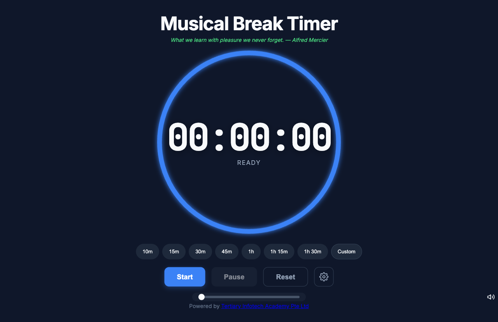

# Musical Class Break Timer

A cyberpunk-styled countdown timer built with vanilla HTML, CSS, and JavaScript. Designed for classrooms, study sessions, and productivity breaks.

## Demo

[**Live Demo**](https://alfredang.github.io/musical-timer-countdown/)



[**User Guide**](https://alfredang.github.io/musical-timer-countdown/docs/)

## Features

### Timer Functionality
- **Preset Times**: Quick-start buttons for 10m, 15m, 30m, 45m, 1h, 1h 15m, and 1h 30m
- **Progress Slider**: Shows time elapsed; drag it left to reduce the time remaining, even while the timer is running
- **Editable Break Label**: A flashing "Break Time" label below the countdown — click it to type your own text (e.g. "Lunch Break"), press Enter to save or Esc to cancel
- **Custom Time**: Press **Custom** to set any duration in hours and minutes
- **Accurate Timing**: Uses `Date.now()` for drift-free countdown accuracy
- **Visual Progress Ring**: Large circular progress indicator that scales with the window and shows remaining time
- **Orbiting Beam**: A neon beam with a fading tail circles the ring — faster while the timer runs, frozen when paused, red when time is up
- **Pause & Resume**: Pause the timer and resume from where you left off
- **Reset**: Always-available reset button clears the timer back to 00:00:00

### Sound Alerts
- **3 Built-in Alarm Sounds**: Choose from Dream, Inspire, or Wing
- **Custom MP3 Upload**: Upload your own MP3 file (up to 5MB) as a custom alarm sound
- **Continuous Alert**: Alarm loops until manually stopped when timer reaches zero
- **Silent Mode**: Visual-only alert with no sound
- **Mute Toggle**: Quick mute/unmute button
- **Preview Sound**: Test your selected alarm sound before starting

### Customization
- **6 Themes**: Cyberpunk (default), Standard, Space, Forest, Ocean, and Sunset, each with its own look and animated background
  - **Cyberpunk**: neon HUD ring, glitching digits, and a green heartbeat trace with sound waves moving left to right over a grid floor
  - **Standard**: the clean original design with no effects
  - **Space**: drifting starfield, twinkling stars, and a shooting star
  - **Forest**: fireflies and swaying light rays
  - **Ocean**: rising bubbles and light from the surface
  - **Sunset**: synthwave sky, striped sun, and a pink grid floor
- **Reduced Motion**: Animations switch off for visitors who ask their system for less motion
- **Settings Persist**: Your sound, theme, custom audio, and break label text are saved in localStorage
- **Mobile Responsive**: Fully optimized for all screen sizes

## How to Use

### Setting a Timer
1. **Using Presets**: Click any preset button (10m, 15m, 30m, 45m, 1h, 1h 15m, 1h 30m)
2. **Custom Time**: Press **Custom**, then type your time in the HR:MIN fields

### Timer Controls
- **Start**: Begins the countdown
- **Pause**: Pauses the timer (button changes to "Resume")
- **Reset**: Clears the timer and all inputs back to 00:00:00

### Changing the Break Label
1. Pick a time so the "Break Time" label appears below the countdown
2. Click the label and type your own text, such as "Lunch Break" (up to 30 characters)
3. Press **Enter** or click away to save; press **Esc** to cancel. Clearing the text restores "Break Time"

### When Timer Completes
- The display shows "Time's Up!" with a flashing animation
- Your selected alarm sound plays continuously
- Click **Stop Alarm** to silence the alarm and reset

### Customizing Settings
1. Click the **gear icon** (right of the Reset button) to open Settings
2. **Alarm Sound**: Select from built-in sounds or choose "Custom" to upload your own MP3
3. **Custom Upload**: Click "Upload MP3" to select a file (max 5MB)
4. **Theme**: Choose from 6 themes
5. Settings are automatically saved

## Project Structure

```
musical-timer-countdown/
├── index.html          # Main HTML structure
├── css/
│   └── style.css       # Styling, themes, and responsive design
├── javascript/
│   └── script.js       # Timer logic and audio handling
├── assets/
│   ├── image1.jpeg     # Preview of the earlier design
│   ├── image2.jpeg     # Settings preview of the earlier design
│   └── sounds/         # Built-in audio files
├── screenshot.png      # App screenshot used in this README
├── docs/
│   └── index.html      # User guide (GitHub Pages)
└── README.md
```

## Technologies

- **HTML5**: Semantic markup with SVG progress ring
- **CSS3**: CSS Variables for theming, Flexbox/Grid layouts, container query units, masks, and keyframe animations for every effect (no canvas, no images)
- **JavaScript (ES6+)**: Class-based architecture, Web Audio API for sound synthesis
- **No Dependencies**: Pure vanilla implementation, no frameworks required

## Browser Support

Works on all modern browsers that support:
- CSS Custom Properties (CSS Variables), `color-mix()`, and container query units
- Web Audio API
- ES6+ JavaScript features
- File API (for custom MP3 upload)

## Getting Started

1. Clone the repository:
   ```bash
   git clone https://github.com/alfredang/musical-timer-countdown.git
   ```
2. Open `index.html` in your browser
3. No build process or server required!

## Sound System

The app includes 3 built-in alarm sounds:
- **Dream**: `Dream.mp3` - Calm, dreamy melody
- **Inspire**: `Inspire.mp3` - Uplifting tune
- **Wing**: `Wing.mp3` - Light, airy sound

**Custom Audio**: Upload your own MP3 file (up to 5MB) which will be stored in your browser's localStorage for future use.

## License

MIT License - Feel free to use and modify for your own projects.

---

Powered by **Tertiary Infotech Academy Pte Ltd**
